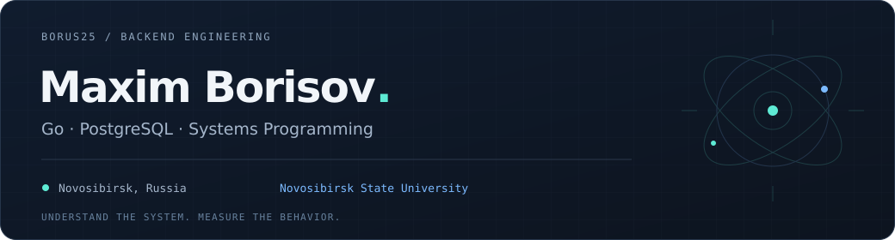
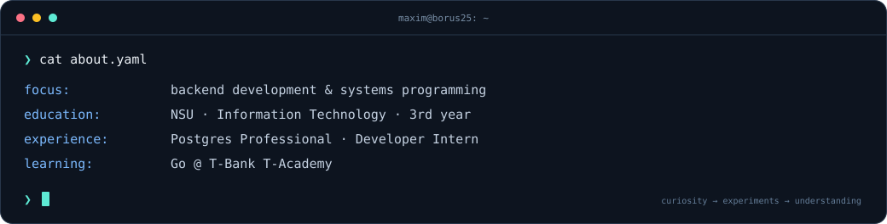

  
  
  

<a href="#-about-me">About</a> ·
<a href="#-tech-stack">Stack</a> ·
<a href="#-experience">Experience</a> ·
<a href="#-selected-work">Projects</a> ·
<a href="#-achievements">Achievements</a>

 

## 👨‍💻 About me

I like looking beneath the abstractions: how processes communicate, how databases replicate data, and what determines latency under load.
My focus is **Go backend development**, **PostgreSQL internals**, and understanding systems through measurements and experiments.

## 🛠️ Tech stack

<strong>Languages</strong>

  
  
  

<strong>Databases</strong>

  
  
  

<strong>Tools</strong>

  
  
  
  

**Practical focus:** HTTP APIs · SQL · WAL &amp; streaming replication · shared memory · load testing

<b>📚 Additional background</b>

C++ and Java through university OOP courses and additional training; algorithms and data structures at NSU.

## 💼 Experience

### Postgres Professional · Developer Intern

**June — August 2026**

Developed an experimental **PostgreSQL replication testbed** to investigate how replica-side delays affect transaction latency.

- Modified server-side **C code** to introduce configurable delays at the WAL write, flush, and replay stages.
- Implemented runtime configuration through an **HTTP API** and **shared memory**.
- Built workload-generation and visualization tools to investigate behavior under load.
- Presented the project at **PgConf.SummerSchool 2026**.

`C` `PostgreSQL` `Python` `HTTP API` `GDB`

## 📌 Selected work

<table>
<tr>
<td width="50%" valign="top">
<h3>🐘 PostgreSQL Replication Testbed</h3>

Experimental environment for reproducing replication delays and studying their impact on transaction execution.

<code>C</code> <code>PostgreSQL</code> <code>HTTP API</code>

<a href="https://github.com/Borus25/postgres-stand-for-test-synchronous">Explore repository →</a>

</td>
<td width="50%" valign="top">
<h3>📊 Monitoring &amp; Visualization</h3>

Tools for collecting experiment results, tracking replication behavior, and visualizing transaction latency as parameters change.

<code>Monitoring</code> <code>Load Testing</code> <code>Data Visualization</code>

<em>Part of the replication testbed project.</em>

</td>
</tr>
<tr>
<td width="50%" valign="top">
<h3>🌐 Go Networking Labs</h3>

University networking coursework implemented in Go.

<code>Go</code> <code>Computer Networks</code>

<a href="https://github.com/Borus25/NSU_Networks_5semestr">Explore repository →</a>

</td>
<td width="50%" valign="top">
<h3>🔎 TE AI Hack</h3>

Hackathon project: an AI-powered interface for smart search.

<code>Python</code> <code>AI</code> <code>Hackathon</code>

<a href="https://github.com/Borus25/TE_AI_Hack">Explore repository →</a>

</td>
</tr>
</table>

## 🏆 Achievements

| Result | Event &amp; project |
| :--- | :--- |
| 🥉 **3rd place** | **Sistema Hack: Novosibirsk** · CDEK track — AI tool for assessing employee and partner burnout |
| 🏅 **Finalist** | **TE AI Hack** · True Engineering &amp; NSU — AI-powered smart search |
| 🎯 **5th place** | **Global ERP learning visualization hackathon** · STIK ecosystem |
| 🎤 **Speaker** | **PgConf.SummerSchool 2026** · Testbed for studying weak synchrony in PostgreSQL replication |

## 🎓 Education

**Novosibirsk State University** · 2024 — present  
Faculty of Information Technology · Software Engineering and Computer Science

<b>🌱 Courses &amp; additional training</b>

- **Go** — T-Bank T-Academy; currently studying.
- **Python** — Yandex Academy Lyceum.
- **C++** — MIPT &amp; Yandex courses.
- **Java** — SHIFT / CFT.
- **SQL** — Stepik.

 

🏀 Basketball &nbsp; · &nbsp; 🏒 Hockey &nbsp; · &nbsp; 🪐 Space

